# Generated examples and brand assets

Actual local-browser captures from the product trials. Still and Nook demonstrate
fictional product workflows; their functional assistants remain deferred.
Pacekeep shows the local functional control with synthetic verification data.
The GIFs sample the running browser at 10 fps and are visual evidence, not
animation-performance measurements. The [capture manifest](media/manifest.json)
records dimensions/timing context, file sizes, and hashes.

## Still — assistant showcase

Pending preview → approval feedback → replay, captured from the actual site:

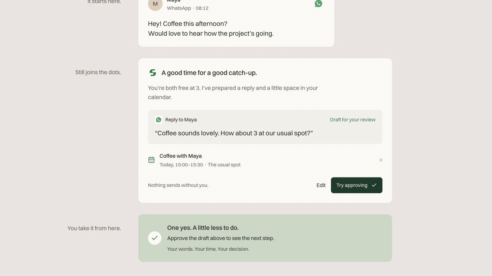

Still on mobile

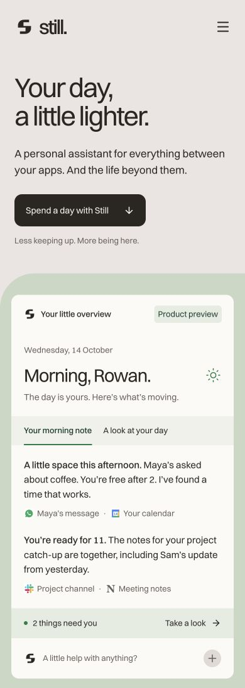

## Nook — fresh implementation retry

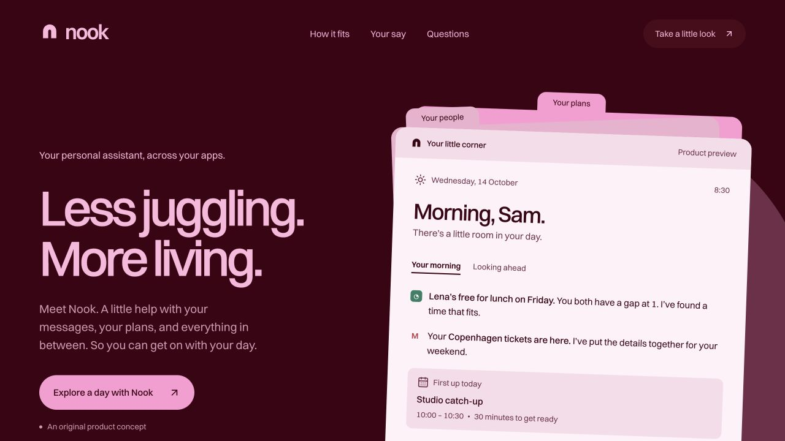

Approval/replay and the follow-up/travel panels, including the browser's scrolling
and the site's transitions:

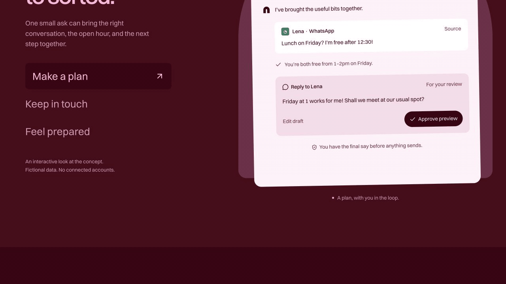

Nook on mobile

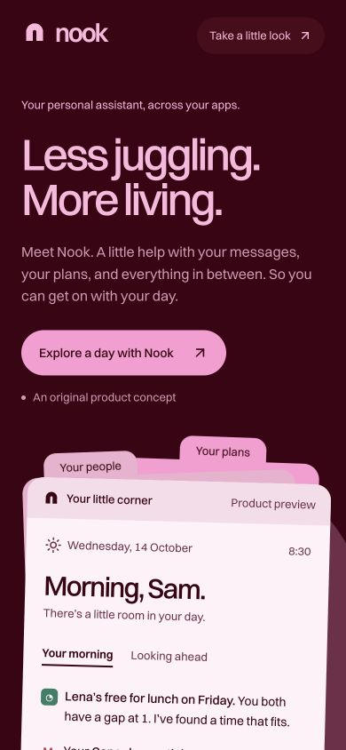

[Full mobile page capture](media/nook-mobile-full.jpg)

## Brand assets

These are the original generated logo/icon marks and delivered social images.
The marks are shown in their touch-icon application; the SVG sources remain
available. Wordmarks and typography appear in the pages and social cards.

### Still

[Original SVG](media/still-mark.svg). Switzer typography; rose-grey `#ebe5e3`,
brown ink `#2b2622`, action green `#0f7d45`, and dark-green logo/share variant `#153c2d`.

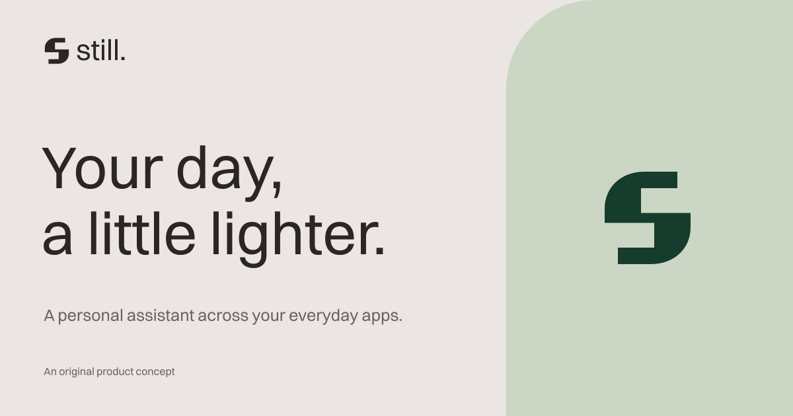

### Nook

[Original SVG](media/nook-mark.svg). Switzer typography; berry `#3d0012`,
rose `#722d4a`, pink `#ff99d3`, and light-pink text `#ffb6dd`.

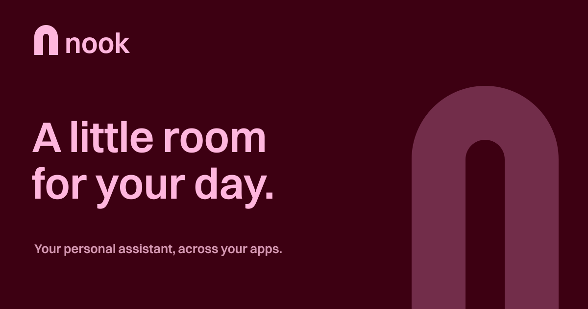

### Tallypace

[Original SVG](media/tallypace-mark.svg). Albert Sans typography; putty `#dedad3`,
paper `#eeebe6`, black `#0a0a0a`, and teal `#256f82`.

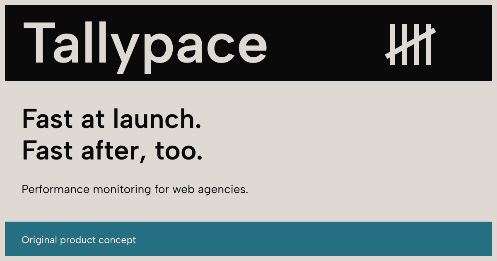

## Earlier PageSpeedPlus trials

Tallypace marketing site

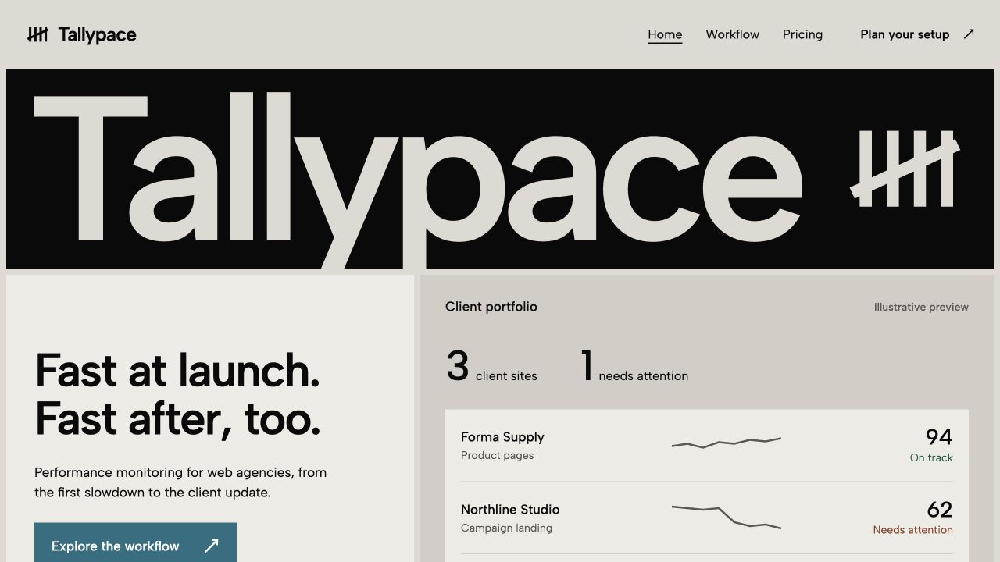

Pacekeep local full-stack control

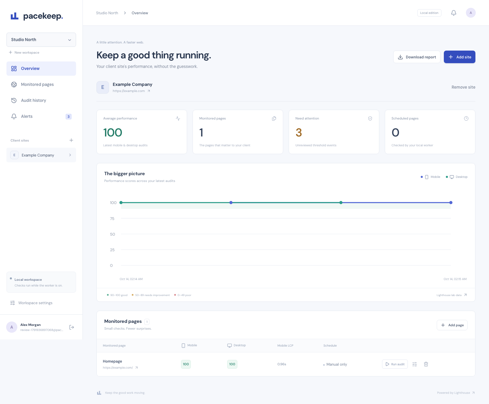

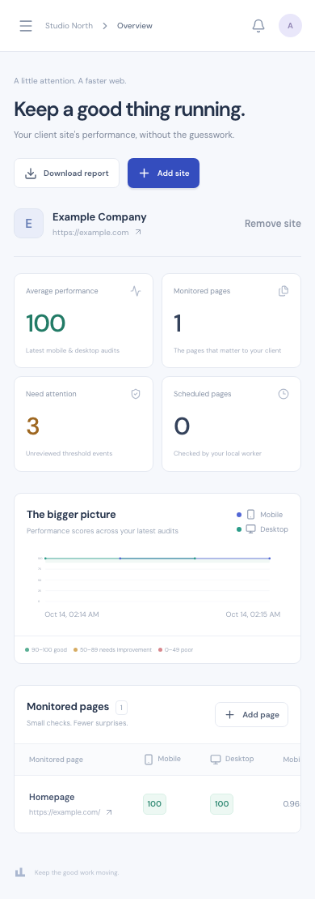

Read the [assistant-showcase results](results.md) and
[PageSpeedPlus results](../pagespeedplus/results.md) for assistance, checks, and
verification limits. Images show the generated outputs; they do not replace the
behavioral evidence or establish an unassisted pass rate.
