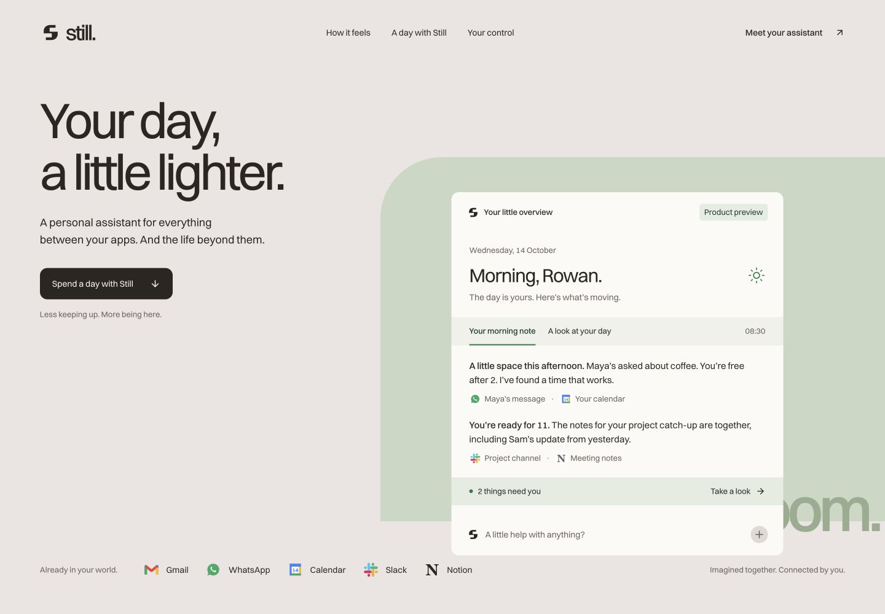

# Observed assistant-showcase trial — 2026-10-14

This follow-up uses a different product category and the corrected PageSpeedPlus catalog at `463677d6eb154b3907efeb02176f0cd5d94ca650`. A history-free agent received the ordinary product request in [protocol](protocol.md), without the maintenance discussion, named skills, or grading criteria. Its consumer repository is separate from this package. Normal client/global skills remained available; this is an observed trial, not an isolated model comparison or an estimated pass rate.

## Reference and scope

[Individu's public site](https://individu.ai/) presents a personal assistant through briefing, feed, chat, approval, tasks, and automation interfaces. Its relevant presentation lesson is to explain the product with coherent screens and workflows. The new product has its own identity and fictional content; it does not reuse Individu's assets, customer data, integration count, or capabilities as evidence.

The agent asked about hosting before implementation, noting that the globally available Sites workflow otherwise defaults to private publication. The owner required local-only work, no remote deployment/provisioning, and a preview on port 3103. This was an ordinary scope answer, not a skill-selection or implementation correction. No public deployment was authorized. The brief already specified a personal assistant, original identity, marketing showcase, and actual-app deferral; the run did not repeat those settled choices as questions.

## Reusable guidance

The earlier marketing result's weak product-showcase emphasis and the owner's feedback motivated a conditional [product-showcase reference](../../skills/revyo-design/references/product-showcase.md), linked from the existing design router. It combines Taste's site direction with product-interface craft, consistent fictional scenarios, readable mobile compositions, and meaningful local demonstration states. It does not impose a particular visual style, device frame, number of sections, or remote app implementation. The brand asset reference now explicitly checks the delivered typeface, using embedded licensed fonts or outlined glyphs when necessary, following the earlier Arial fallback finding.

These additions were made after this run was dispatched and were not present in its initial installed catalog. Its initial result therefore tests the earlier corrections rather than proving discovery of the new showcase reference. Evidence of any later installed-guidance review is reported separately. The source snapshots remain intact and the catalog still contains 164 skills.

## First runnable implementation and corrections

The agent chose **Still**, with a rose-grey, brown-ink, and forest-green identity,
Switzer typography, and a large daily-overview interface in the hero. It built a
coffee conversation through context, an editable draft/event, approval, and replay;
morning/midday/evening views; searchable workflow suggestions; permission previews;
and FAQ/navigation. The evaluator opened the actual site, inspected the hero, edited
the reply, approved it, and replayed the journey. The resulting state explicitly
said that no message was sent. This passes the product-showcase and app-deferral
checks at the first runnable checkpoint.

Two earlier defects **recurred**: the share generator used Arial despite Switzer
being the chosen brand font, and the workspace exposed build/type/four content
tests without fresh-coverage/shared CRAP commands. The generator also imported
Sharp from an absolute path in the maintainer's local tool cache, making asset
regeneration nonportable. These were findings in the runnable checkpoint while
the agent was still performing final browser/asset checks, not a claim that it
had already declared the complete handoff finished.

The owner supplied all three concrete findings and refreshed the installed
guidance without modifying the app. Later completion is therefore **assisted**.
The asset reference now explicitly covers rendered brand typography and portable
regeneration. The project completion section explicitly requires running its
existing phase quality contract before handoff; it does not introduce a new
threshold or rewrite upstream snapshots. The baseline's missing database is
appropriate to app deferral, so the earlier functional PostgreSQL failure is not
counted as either a pass or a recurrence in this trial.

## Assisted Still completion

Still's final frozen-lockfile install, type check, production static build, asset
generation, Turbo task graph, and 12 behavioral/asset tests passed. The source-mapped
coverage and shared gate include the application and asset generator: 54 functions
across six source files, no failures, maximum CRAP 7. Instrumented coverage is
98.26% lines, 97.54% statements, 98.14% functions, and 93.33% branches, with 90/90/90/80
aggregate gates. Above-threshold and missing-report negative controls were checked.
See [quality evidence](still-quality.json).

The delivered share card is generated from actual bundled Switzer outlines using
declared Fontkit/Sharp dependencies. Independent anonymous GETs for ordinary,
Googlebot, and Twitterbot user agents returned 200, local noindex metadata, a
large-image Twitter card, and the correct localhost share URL without a fabricated
public canonical. All seven local navigation targets resolved. The PNG card is
1200 × 630 and the touch icon 180 × 180, with image MIME types and decodable bytes;
the resulting card was visually inspected. All 1,107 managed skill files match
both the installer manifest and the corrected catalog. See [HTTP evidence](still-http.json).

Browser QA covered 1440/768/390px layouts, overview and day tabs, keyboard tab
navigation, the editable approval/replay flow, mobile navigation, command search
and empty results, and FAQ. The evaluator separately inspected the actual hero,
approval/replay interaction, and saved desktop/mobile images. The Taste Chromium
inspector could not launch; the available in-app browser provided responsive and
interaction checks. Its full automated visual gates and a full assistive-technology
audit remain unverified. The actual assistant, auth, account connections, message
delivery, durable memory, billing, and production hosting remain deferred.

[Mobile composition](still-mobile.jpg) · [Corrected social card](still-og.png)

## Independent routing probe

A second history-free agent received the planning-only request recorded in the
protocol and a fresh installation containing the new reference. It reported
reading project planning, design, product-showcase, and Taste guidance. It left the
repository unchanged and proposed a legible first-screen demonstration spanning
email, messages, and a calendar conflict, followed by a prepared reply/event,
approval, and replay. Fictional people/times/states remain consistent and mobile
composition shows readable panels. It asked about audience, existing identity,
and the real conversion destination before implementation. It retained app
deferral with no unnecessary auth, account connections, or database.

This passes the bounded routing/planning check. Selection is self-reported rather
than a raw tool-read trace; no second app was implemented. No host mode-control
transition is established by this planning-only result.

## Fresh implementation retry

A third history-free agent received the original implementation prompt and a fresh
installation of correction `d5dbb517bcdfafeb0ce7c17d19a6dba89ff5c30c`. The only
additional owner input before handoff required local-only operation on port 3104.
No prior defect, skill name, evaluation rubric, or implementation correction was
supplied before its initial handoff.

It delivered **Nook**, an original berry-and-pink identity with an arch motif and
a large, legible briefing interface in the hero. Three cross-app examples show
lunch planning, a proposal follow-up, and travel preparation with editable drafts,
approval, and replay. It also includes context notes/routines, illustrative
permission controls, FAQ, and meaningful local conversion interactions. The
actual app remains deferred with no account connections or remote resources.
The evaluator separately opened the live site and inspected its hero/product UI.

The initial handoff included the fresh-coverage/shared CRAP command from scaffolding,
eight passing behavioral tests, build/types, 100% instrumented application coverage,
and all 27 application functions passing with maximum CRAP 4. Its asset generator
used a declared Sharp dependency and bundled Switzer TTF, with no absolute tool-cache
import or literal Arial substitution. The generator then had top-level statements
and no functions; it was outside the application coverage percentage. The missing
quality-command and nonportable-import defects did not recur in that initial handoff.

An independent typography control rendered the same word in two separate Node
processes, with and without the supplied `fontfile`, and obtained identical PNG
bytes. The evaluator initially called this a fallback; that interpretation was
corrected because Switzer variable fonts were also installed on this machine.
The control was **inconclusive**, not proof that the delivered font was wrong. It
could not establish independence from system font registration.

The owner requested direct glyph outlines from the bundled file to remove that
uncertainty and included the new generator functions in fresh coverage. This final
font-source hardening is assisted and is not counted as a fully unassisted first-pass
success. The asset reference now distinguishes a font declaration/file argument
from verified glyph provenance. No claim is made that the original Nook raster
was proven to use the wrong font.

Nook's final handoff passes ten tests, build/types, and all 29 measured functions
across five source files, including both new glyph-generation functions, with
maximum CRAP 4. Instrumented application/glyph-helper coverage is 100% for lines,
statements, functions, and branches. Its asset CLI has zero functions, independently
confirmed by the shared parser; that top-level launcher is outside the aggregate
percentage and was executed separately. See [quality evidence](nook-quality.json).

The evaluator independently ran the documented asset command in two separate
processes with font discovery disabled. Both produced SHA-256
`9651a8ca25765943b6a7c8c5569984009df096c903f1ed9f4f890a120b934299`, matching the actual
served 1200 × 630 PNG. The bundled TTF, source SVG paths, and raster were inspected.
Ordinary, Googlebot, and Twitterbot GETs returned 200 with noindex, a large-image
Twitter card, a correct local share URL, no invented public canonical, and no
broken local navigation targets. The 180 × 180 touch icon and SVG favicon were
also fetched. All 1,107 managed files match the final installed catalog. See
[HTTP evidence](nook-http.json) and the [final social card](nook-og.png).

Desktop/tablet/mobile checks at 1440/768/390px and an editable approval journey
passed in the implementation agent's browser checks; the evaluator separately
inspected the live product hero. A later screenshot-export attempt in the hidden
subtask could not access its browser, so this report does not imply saved Nook UI
screenshots. Still's saved images and the directly fetched Nook social raster are
included. The full Taste Chromium inspector and a full assistive-technology audit
remain unverified. Actual assistant services and public deployment remain deferred.

## Outcome and limits

The follow-up established a product-led showcase and a fresh implementation with
quality commands present, working local preview journeys, and project-relative
asset dependencies. It also exposed repeated first-checkpoint omissions in the
baseline and prompted an assisted, verifiable glyph-source refinement in the
retry. These observations support the narrow guidance changes; they do not show
that every future run will select every relevant skill or complete without review.
Skill selection in the subagent runs is self-reported; the rendered UI, managed
file integrity, source/configuration, coverage/gate artifacts, and image delivery
were inspected separately. No host Plan-mode control was exposed, so planning
behavior is not evidence of an actual mode transition.
